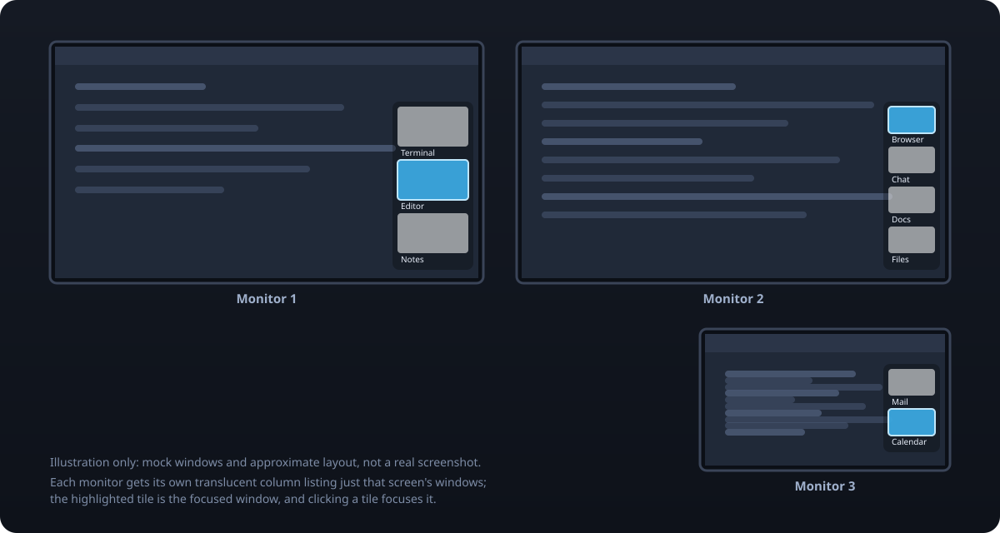

<div align="center">


# Plasma Window Overlay

**Always-visible, translucent window thumbnails on every monitor.**
A KDE Plasma 6 widget that answers "where did that window go?" at a glance.

[](https://github.com/bootswithdefer/plasma-window-overlay/actions/workflows/ci.yml)
[](https://github.com/bootswithdefer/plasma-window-overlay/releases)
[](LICENSE)


</div>



<sub>Illustration made from mock windows, not a real screenshot. See [Screenshots](#screenshots).</sub>

## Why

If you keep every window maximized across several monitors, it gets hard to remember which
window is on which screen once you pass three or four of them. The taskbar lists them, and you
can Alt+Tab, but neither tells you *at a glance* what is on each screen.

Window Overlay puts a small, translucent column of live thumbnails along the edge of **each
monitor**, listing only the windows on that monitor. Click a tile to focus that window.

## Features

- **One overlay per monitor**, each showing only that screen's windows
- **Live thumbnails** with the window title and icon, using the same screencasting mechanism as
  the Task Manager's hover previews
- **Click to focus** a window, with the focused window highlighted
- **Translucent and always on top**, so it sits over maximized windows without hiding them
- **Follows your windows**: tiles appear, disappear and resize as windows open, close or move
  between screens
- **Fits any window count**: thumbnails shrink to keep the column on the screen
- **Respects virtual desktops and activities**: shows the windows of the current ones
- **Configurable**: side of the screen, thumbnail size, opacity, position and margins
- **Panel toggle**: click the widget's panel icon to hide or show the overlays

## Requirements

- KDE Plasma **6** (developed and tested on 6.8.2)
- A **Wayland** session. It is developed and tested on Wayland only; X11 is untested and
  window placement there may differ.
- PipeWire (a default part of a Plasma 6 desktop), used for window thumbnails

## Install

### From a release (recommended)

Download `org.defer.windowoverlay-<version>.plasmoid` from the
[Releases page](https://github.com/bootswithdefer/plasma-window-overlay/releases), then:

```sh
kpackagetool6 --type Plasma/Applet --install org.defer.windowoverlay-<version>.plasmoid
```

You can also use **Add or Manage Widgets → Get New Widgets → Install Widget From Local File…**.

To upgrade, use `--upgrade` instead of `--install`, then restart Plasma:

```sh
systemctl --user restart plasma-plasmashell
```

### From source

```sh
git clone https://github.com/bootswithdefer/plasma-window-overlay.git
cd plasma-window-overlay
./scripts/install.sh
```

### Uninstall

```sh
kpackagetool6 --type Plasma/Applet --remove org.defer.windowoverlay
```

## Use

1. Right-click your panel and choose **Add or Manage Widgets**.
2. Search for **Window Overlay** and drag it onto a panel. It appears as a small icon.
3. The overlays appear on every monitor. Click the icon to hide or show them.

The widget needs to live in a panel (or the system tray) to keep running, but the overlays
themselves are separate windows and float anywhere on screen.

To try it without adding it to a panel:

```sh
plasmawindowed org.defer.windowoverlay
```

Closing that test window stops the overlays.

## Configure

Right-click the widget's icon and choose **Configure Window Overlay…**

| Setting | Default | What it does |
| --- | --- | --- |
| Screen side | Right | Put the column on the right or left edge of each screen |
| Thumbnail width | 260 px | Width of each tile (height follows at 16:9) |
| Thumbnail opacity | 60 % | How see-through the thumbnails are |
| Backdrop opacity | 25 % | Opacity of the dark panel behind the tiles |
| Top of column | 25 % | Where the column starts, as a percentage of the screen height |
| Gap from screen edge | 12 px | Distance from the side of the screen |
| Keep clear at bottom | 64 px | Space left at the bottom so the column stays above your taskbar |

## How it works

The widget is a regular Plasma applet that runs in a panel. For each screen it opens a
borderless, always-on-top `PlasmaCore.Dialog` and fills it with tiles from a
`TaskManager.TasksModel` filtered to that screen. Each tile's thumbnail is a PipeWire stream
requested through `TaskManager.ScreencastingRequest`, the same building blocks the stock Task
Manager uses for its previews. A new window is often not streamable for a moment after it
appears, so the tile retries its request until frames arrive.

## Known limitations

- **Taskbar overlap is a fixed margin.** The overlay cannot tell which monitors have a panel or
  how tall it is, so the bottom margin applies to every screen. Tune it in the settings.
- **Wayland only** has been tested. X11 may place the overlays differently.
- **The thumbnail shape is fixed at 16:9**, so windows with a very different shape are scaled
  to fit that box.
- **Mixed-scaling multi-monitor setups** have only been tried on one configuration.
- A **fullscreen window** (such as a game or video) can cover the overlay, depending on how
  your compositor stacks it.

Bug reports with your Plasma version, session type and monitor layout are very welcome.

## Screenshots

The picture at the top is an illustration drawn from mock windows, because real screenshots of
this widget would show whatever is open on the author's desktop. Real screenshots of the widget
running over harmless windows are welcome as a pull request. Please crop out anything private,
and put them in `docs/`.

## Development

```sh
./scripts/check.sh     # metadata, config schema, SVGs, qmllint
./scripts/build.sh     # builds dist/<id>-<version>.plasmoid
./scripts/install.sh   # installs or upgrades into your user profile

# Run with logging while you work:
QT_FORCE_STDERR_LOGGING=1 plasmawindowed org.defer.windowoverlay
```

The package lives in [`package/`](package). Settings are declared in
`package/contents/config/main.xml` and edited in `package/contents/ui/configGeneral.qml`;
`check.sh` verifies that every setting used in the QML is declared and vice versa.

`docs/overview.svg` is generated by `scripts/make_overview.py`.

### CI and releases

- **CI** (`.github/workflows/ci.yml`) runs on every push and pull request: static checks,
  `qmllint`, a package build, an install test with `kpackagetool6` on a clean Arch container,
  ShellCheck, workflow linting, and a link check on the docs. The built package is uploaded as
  a workflow artifact.
- **Release** (`.github/workflows/release.yml`) runs when a `vX.Y.Z` tag is pushed. It verifies
  the tag matches the package version, rebuilds, and publishes a GitHub release with the
  `.plasmoid` file, its checksum, and notes taken from the changelog.
- **Dependabot** keeps the GitHub Actions versions current.

To cut a release:

```sh
./scripts/bump-version.sh 0.2.0     # updates metadata.json and CHANGELOG.md
git commit -am "Release 0.2.0"
git tag v0.2.0
git push --follow-tags
```

See [CONTRIBUTING.md](CONTRIBUTING.md) for more.

## License

[MIT](LICENSE) © 2026 bootswithdefer
